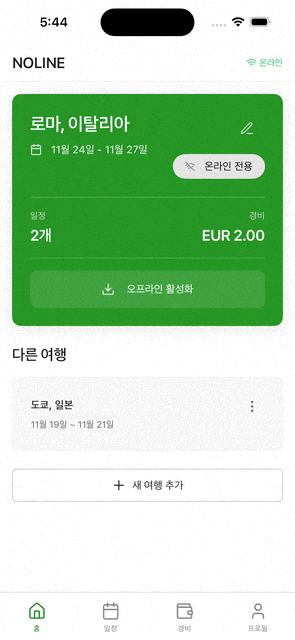
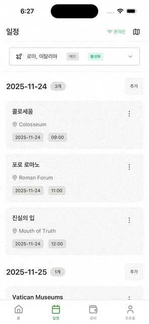
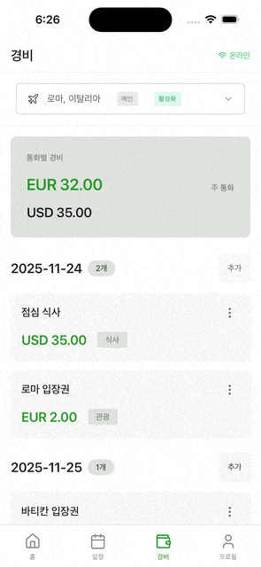
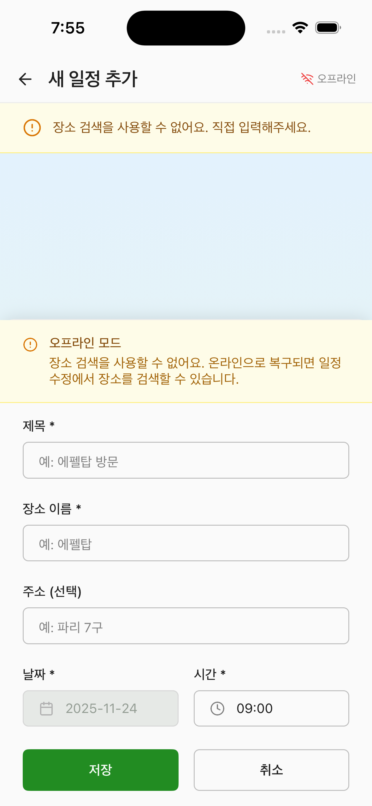
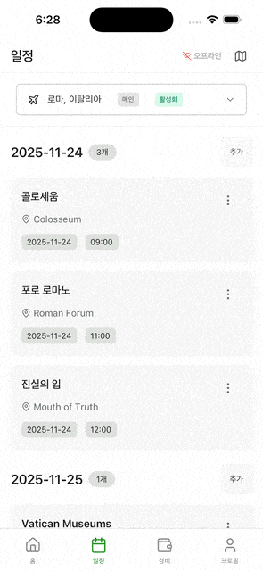
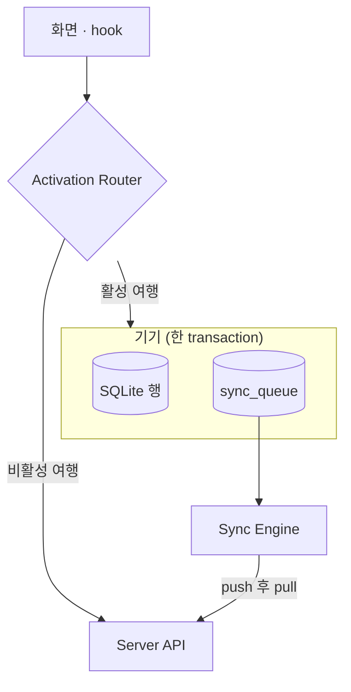

<div align="center">
  <h2>NOLINE</h2>
  <p><strong>네트워크가 없어도 여행은 계속된다</strong></p>

  <p>
    
    
    
  </p>

  <p>
    <a href="https://apps.apple.com/kr/app/noline/id6757186547">
      
    </a>
  </p>
</div>

Noline은 여행 중 연결이 끊겨도 일정과 경비를 기록할 수 있는 iOS 앱입니다. 떠날 여행 하나를 미리 기기에 받아 두면 오프라인에서도 그대로 쓸 수 있고, 연결이 돌아오면 서버와 동기화합니다. 이렇게 고른 여행만 기기에 두는 구조를 **Selective Local-First**라고 부릅니다.

## 목차

- [Motivation](#motivation)
- [Preview & Features](#preview--features)
- [Architecture: 선택과 책임](#architecture-선택과-책임)
  - [1. 모든 여행 대신 활성 여행에 준비를 집중한다](#1-모든-여행-대신-활성-여행에-준비를-집중한다)
  - [2. 오프라인에서 저장한 변경을 서버까지 전달한다](#2-오프라인에서-저장한-변경을-서버까지-전달한다)
  - [3. 여러 기기의 편집은 항목 단위로 맞춘다](#3-여러-기기의-편집은-항목-단위로-맞춘다)
  - [4. 아직 보내지 못한 변경은 지우지 않는다](#4-아직-보내지-못한-변경은-지우지-않는다)
- [UI State: 불안정한 연결에서 화면이 지키는 것](#ui-state-불안정한-연결에서-화면이-지키는-것)
  - [사용자에게 지키는 세 가지](#사용자에게-지키는-세-가지)
  - [한 가지만 아는 훅을 조합해 화면 상태 하나를 만든다](#한-가지만-아는-훅을-조합해-화면-상태-하나를-만든다)
  - [늦게 도착한 응답이 최신 상태를 덮지 않게 한다](#늦게-도착한-응답이-최신-상태를-덮지-않게-한다)
- [Tech Stack & Structure](#tech-stack--structure)
- [Quick Start](#quick-start)
- [현재 한계](#현재-한계)

## Motivation

해외 여행에서는 비행기 탑승, 로밍 제한, 불안정한 현지 연결 때문에 서버에 항상 접근할 수 없습니다. 그때도 이미 준비한 여행의 일정을 보고 새 기록과 지출을 남길 수 있어야 합니다.

그렇다고 모든 여행을 항상 기기에 복제하면 지도 저장공간과 동기화 책임이 커집니다. 그래서 Noline은 실제로 떠날 여행 하나에 오프라인 준비를 집중합니다.

## Preview & Features

<table>
  <tr>
    <td align="center" width="33%">
      <br />
      <strong>여행 활성화</strong><br />
      떠날 여행 하나를 기기에 준비
    </td>
    <td align="center" width="33%">
      <br />
      <strong>일정과 지도</strong><br />
      목록과 지도를 오가며 일정 확인
    </td>
    <td align="center" width="33%">
      <br />
      <strong>다중 통화 경비</strong><br />
      통화별로 나눠 보는 합계
    </td>
  </tr>
  <tr>
    <td align="center">
      <br />
      <strong>오프라인 직접 입력</strong><br />
      검색 없이 장소 이름으로 저장
    </td>
    <td align="center">
      <br />
      <strong>오프라인 저장</strong><br />
      보낼 변경을 기기에 보관
    </td>
    <td align="center">
      <br />
      <strong>연결 복구 후 동기화</strong><br />
      연결이 돌아오면 서버와 맞춤
    </td>
  </tr>
</table>

- **필요한 여행의 오프라인 준비** — 여행을 만들고 실제로 떠날 여행 하나를 활성화합니다. 활성화하면 그 여행의 일정과 경비를 기기로 받아 오고, 지도와 경로는 이어서 백그라운드로 준비합니다.
- **일정과 지도** — 일정을 날짜·시각과 함께 기록하고 목록과 지도를 전환합니다. 온라인에서는 장소 검색과 Google 지도를, 활성 여행의 오프라인에서는 준비해 둔 Mapbox 지도를 사용합니다.
- **다중 통화 경비** — 경비를 날짜와 통화·카테고리로 기록하고 통화별로 합계를 확인합니다. 서로 다른 통화를 환율로 환산해 하나의 합계로 섞지 않습니다. 경비는 같은 여행의 일정 하나에 연결할 수 있습니다.
- **오프라인 기록과 서버 동기화** — 활성 여행에서는 연결이 없어도 일정과 경비를 저장합니다. 연결이 돌아오면 기기의 변경을 서버로 보내고 서버의 변경을 받아 옵니다. 여러 기기에서 같은 일정이나 경비를 고쳐도 각자 고친 항목이 함께 남습니다.

여행을 활성화했는지와 지금 연결돼 있는지에 따라 동작이 달라집니다. 사용자가 온라인/오프라인 모드를 직접 바꾸지는 않습니다.

| 여행과 연결 | 일정·경비 | 검색·지도 |
| --- | --- | --- |
| 활성 · 온라인 | 기기에 저장하고 서버와 동기화 | 장소 검색, Google 지도 |
| 활성 · 오프라인 | 기기에 저장 | 장소 직접 입력, 준비해 둔 Mapbox 지도 |
| 비활성 · 온라인 | 서버에 저장 | 장소 검색, Google 지도 |
| 비활성 · 오프라인 | 조회·저장 제한 | 사용 제한 |

화면은 이전 버전에서 녹화한 데모이며 현재 UI와 다를 수 있습니다.

## Architecture: 선택과 책임

데이터가 가는 길은 여행의 활성 여부에 따라 둘로 갈립니다. 활성 여행은 기기에 저장한 뒤 서버와 동기화하고, 비활성 여행은 서버에 바로 저장합니다.



아래 네 가지는 이 구조를 만들면서 무엇을 고민했고 무엇을 포기했는지에 대한 설명입니다.

### 1. 모든 여행 대신 활성 여행에 준비를 집중한다

**떠날 여행 하나만 기기에 두고, 어디서 읽고 쓸지는 Activation Router 한곳에서 정합니다.**

처음에는 모든 여행을 기기에 자동으로 저장했습니다. 여기에 오프라인 지도를 붙이자, 여행이 늘어날수록 저장 공간과 준비 시간, 정리 책임이 함께 커졌습니다.

| 검토한 대안 | 판단 |
| --- | --- |
| 모든 여행을 저장하고 활성 여행만 동기화 | 저장 공간 문제가 그대로 남는다 |
| 여행 수를 제한하고 오래된 여행을 삭제 | 임의의 제한이고 데이터를 잃을 위험이 있다 |
| 비활성 여행도 오프라인 편집 허용 | 임시 캐시와 서버 데이터의 merge·버전 충돌·정리를 모두 관리해야 한다 |
| **필요한 여행 하나만 활성화** | 채택. 실제로 떠날 여행에만 저장과 동기화 책임을 둔다 |

활성 여행은 기기(Local SQLite)에서, 비활성 여행은 서버에서 읽고 씁니다. 이 분기는 repository가 호출하는 Router에만 있어서, 화면과 hook은 DB와 API를 직접 고르지 않습니다.

```ts
// apps/client/src/entities/expense/repository/expense-repository.ts
getByTripId: async (tripId: string): Promise<Expense[]> => {
  return await routeChildQuery(tripId, {
    local: () => ExpenseLocal.getExpensesByTripIdLocal(tripId), // 활성 여행 → SQLite
    remote: () => ExpenseApi.fetchExpensesByTripId(tripId),     // 비활성 여행 → Server API
  });
},
```

다만 활성 여부 하나로 모든 것을 정할 수는 없었습니다. 처음에는 활성 여행이면 일정·경비뿐 아니라 지도와 장소 검색까지 오프라인 방식으로 동작했습니다. 그래서 활성 여행은 연결이 멀쩡할 때도 온라인 지도와 장소 검색을 제대로 쓰지 못했습니다.

성격이 다른 두 가지를 같은 기준으로 묶은 것이 원인이었습니다. 일정과 경비는 사용자가 소유하고 서버와 동기화해야 하는 데이터입니다. 지도·검색·길찾기는 연결돼 있을 때 가져다 쓰면 되는 외부 서비스입니다. 그래서 둘을 나눠 각각 다른 곳에서 정합니다.

| | 정하는 것 | 기준 |
| --- | --- | --- |
| Activation Router | 일정·경비를 어디서 읽고 쓸지 (기기 또는 서버) | 여행의 활성 여부 |
| Policy | 지금 쓸 수 있는 기능 (작성 가능 여부, 지도 종류, 장소 검색) | 여행의 활성 여부와 연결 상태 |

그 결과 활성 여행도 온라인에서는 장소 검색과 Google 지도를 쓰고, 연결이 끊기면 준비해 둔 Mapbox 지도와 직접 입력으로 바뀝니다. 그동안 일정과 경비는 계속 기기에 저장됩니다.

> **트레이드오프** 활성화하지 않은 여행은 오프라인에서 내용을 보거나 고칠 수 없고, 새 여행도 온라인에서 만듭니다.

선택 과정은 [Selective Local-First 결정](context/project/decisions/0001-selective-local-first.md), 상태별 세부 조건은 [여행 접근·Policy](context/project/guidance/travel-access/INDEX.md)에 있습니다.

### 2. 오프라인에서 저장한 변경을 서버까지 전달한다

**기기의 행과 전송 기록을 한 transaction으로 저장하고, 실패한 전송은 순서대로 다시 보냅니다.**

기기에 행만 저장되고 전송 기록이 빠지면 그 변경은 서버에 도착하지 않습니다. 그래서 행과 `sync_queue` 기록을 같은 transaction에서 확정합니다(Outbox 패턴). 둘 중 하나가 실패하면 함께 되돌립니다.

```ts
// apps/client/src/entities/expense/lib/expense-local.ts (payload 일부 생략)
return await withTransaction(async () => {
  await assertActiveLocalTrip(data.tripId);

  await getDatabase().insert(expenses).values(newExpense);                    // ① 행 저장
  await addToSyncQueue('expenses', id, 'CREATE', { id, userId, /* ... */ });  // ② 전송 기록

  return toExpense(newExpense);
});
```

여기에 네 가지 규칙을 더합니다.

- **ID는 기기에서 만든다** — 오프라인에서는 서버가 줄 ID를 기다릴 수 없습니다. 기기가 ULID를 만들고 서버가 같은 ID를 그대로 저장하므로, 나중에 ID를 바꿔 끼울 필요가 없습니다.
- **순서 보존** — 큐를 쌓인 순서대로 보내고, 요청이 실패하면 그 뒤 작업은 보내지 않습니다. 수정이나 삭제가 생성보다 먼저 도착하지 않습니다.
- **횟수 제한 없는 재시도** — 실패한 작업은 다음 동기화에서 다시 보냅니다. 연결이 자주 끊기는 여행 중에는 일시 오류가 반복되므로, 횟수로 막으면 전송이 멈추고 버리면 입력을 잃습니다.
- **멱등 재전송** — 응답을 잃은 요청을 다시 보내도 서버가 중복으로 적용하지 않습니다.

> **트레이드오프** 큐가 하나라서 통신 오류처럼 결과를 알 수 없는 실패가 풀릴 때까지 뒤의 변경도 기다립니다. 다시 보내도 결과가 달라지지 않는 요청은 예외입니다. 이미 삭제된 기록에 대한 요청은 끝내고, 이전 버전 앱의 충돌 요청은 보류로, 기기 원본을 잃은 요청은 격리로 옮긴 뒤 다음 작업을 이어 보냅니다.

저장이 실패하면 행과 전송 기록이 함께 되돌아가는지는 [SQLite 테스트](apps/client/tests/shared/db/transaction-serialization.test.ts)로, 다시 보낸 요청이 중복 적용되지 않는지는 [PostgreSQL 통합 테스트](apps/server/tests/integration/replay.idempotency.test.ts)로 확인합니다. 나머지 규칙은 [데이터 수명](context/project/guidance/data-lifecycle/INDEX.md)에 있습니다.

### 3. 여러 기기의 편집은 항목 단위로 맞춘다

**일정과 경비는 행 전체를 덮어쓰지 않고, 항목 묶음마다 더 나중의 편집을 남깁니다.**

같은 경비를 휴대폰과 태블릿에서 고쳤을 때, 행 전체를 마지막 요청으로 덮어쓰면 먼저 도착한 편집이 사라집니다. Noline에서는 두 편집이 모두 남습니다.

| | 금액 | 분류 |
| --- | --- | --- |
| 처음 | 25 USD | 식비 |
| 휴대폰 (오프라인) | **30 USD**로 수정 | |
| 태블릿 | | **교통**으로 수정 |
| 두 기기 동기화 후 | 30 USD | 교통 |

수정을 저장할 때마다 편집 표식 `{ time, sequence, id }`를 붙이고, 서버가 항목 묶음마다 표식을 비교해 남길 편집을 정합니다. 금액과 통화처럼 따로 조합하면 아무도 입력하지 않은 값이 되는 항목은 한 묶음으로 다룹니다.

```ts
// packages/schema/src/sync/field-edits.ts
const EXPENSE_EDIT_GROUPS = {
  title: ['title'],
  amount: ['amount', 'currency'], // 금액과 통화는 함께 바뀐다
  category: ['category'],
  date: ['date'],
  scheduleId: ['scheduleId'],
  // ...
} as const;
```

편집이 겹치는 두 가지 경우도 함께 다룹니다.

- **응답을 기다리는 사이 다시 고쳤을 때** — 기기는 서버가 확인해 준 값 위에 아직 처리되지 않은 내 편집을 겹쳐 보여 줍니다. 30으로 저장한 요청의 응답을 기다리는 동안 35로 다시 고쳤다면, 30에 대한 응답이 와도 화면은 35를 유지합니다.
- **이전 버전 앱이 보낸 요청일 때** — 편집 표식이 없는 요청이 서버 값과 충돌하면 자동으로 덮어쓰지 않습니다. 원문을 보관해 두고 사용자가 다시 적용할 항목을 고릅니다.

> **트레이드오프** 표식은 편집 사이의 순서를 일관되게 정할 뿐, 실제로 누가 나중에 눌렀는지까지 알려 주지는 않습니다. 여행 정보(이름·날짜 등) 수정에는 아직 적용하지 않아, 나중에 도착한 요청이 남습니다.

표식 발급과 응답 반영의 전체 흐름은 [여러 기기 편집 기준](context/project/guidance/data-lifecycle/edit-reconciliation.md)에 있습니다.

### 4. 아직 보내지 못한 변경은 지우지 않는다

**기기 사본을 비우는 일이 사용자의 기록을 지우는 일이 되지 않게 합니다.**

여행을 해제하거나 로그아웃할 때, 서버에 보내지 못한 일정과 경비까지 함께 사라지면 안 됩니다.

- **여행 해제** — 보내지 못한 변경이 있으면 기기 사본을 남기고 정리를 예약합니다. 남은 변경이 없어진 뒤에 정리하며, 그 전에 같은 여행을 다시 활성화하면 예약을 취소합니다. 기기 사본 정리는 서버의 여행을 삭제하지 않습니다.
- **기록 삭제** — 사용자가 삭제한 기록은 삭제 표시로 남아 서버 전달을 기다리고, 7일이 지나고 그 행을 참조하는 전송 요청이 없어야 실제로 지울 수 있습니다. 7일은 지우기 전에 두는 유예 기간이며, 삭제를 되돌리는 기능은 아닙니다.
- **로그아웃·탈퇴** — 보내지 못한 변경이 남아 있으면 보류합니다. 사용자가 폐기를 명시적으로 확인한 때만 기기 데이터를 비우며, 폐기한 변경은 복구할 수 없습니다.
- **로그인 만료** — 통신 장애를 로그아웃으로 처리하지 않습니다. 재인증이 필요한 동안에도 같은 계정의 활성 여행은 기기에서 계속 이용할 수 있고, 서버 요청과 새 동기화만 멈춥니다.

정리 조건과 한계는 [여행 사본 정리](context/project/guidance/data-lifecycle/INDEX.md#여행을-정리할-때-모든-미전송-상태와-현재-활성-여부를-확인한다), 세션과 계정 종료의 흐름은 [앱 실행·세션·데이터 보존](context/project/current/app-runtime/INDEX.md)에 있습니다.

## UI State: 불안정한 연결에서 화면이 지키는 것

연결이 불안정할 때 사용자가 가장 곤란한 순간은 화면을 믿을 수 없을 때입니다. 0원이 정말 0원인지, 쓰던 내용이 남아 있는지, 왜 막혔는지 알 수 없는 순간입니다. 그래서 Noline의 화면은 세 가지를 지킵니다. 모르는 것을 없다고 보여 주지 않고, 쓰던 입력을 지우지 않고, 막혔으면 이유를 그 자리에서 알립니다.

이 판단을 화면마다 따로 쓰면 화면 수만큼 조건이 흩어지고 서로 어긋납니다. 그래서 한 가지만 아는 훅을 조합해 한곳에서 판단하고, 화면은 그 결과만 받아 그립니다.

### 사용자에게 지키는 세 가지

**모르는 것을 없다고 보여 주지 않는다**

- 조회에 실패했을 때 빈 목록이나 0원으로 그리지 않습니다. 0원은 조회에 성공했을 때만 보입니다.
- 갱신만 실패하면 보던 내용을 지우지 않고, 그 자리에 "갱신하지 못했어요. 이전 내용을 표시하고 있어요"를 덧붙입니다.
- 홈의 여행 카드는 일정과 경비를 따로 판정합니다. 경비 조회가 실패해도 일정 수는 그대로 보입니다.
- 연결 여부를 아직 모를 때 오프라인으로 단정하지 않습니다. "확인 중"으로 표시하고, 10초가 지나도 알 수 없으면 "확인 불가"로 바꿉니다.

**쓰던 입력을 지우지 않는다**

- 작성 도중 연결이 바뀌어도 폼을 다른 화면으로 바꾸지 않습니다. 장소 검색이나 저장처럼 지금 실행할 수 없는 영역에만 안내를 붙입니다.
- 연결이 돌아와도 자동으로 제출하지 않고, 저장에 실패하면 입력을 그대로 둡니다.
- 일정 수정 화면은 아직 이 기준을 지키지 못합니다. 수정이 제한되면 입력 영역 전체가 안내로 바뀝니다.

**막힌 이유를 그 자리에서 알린다**

- 볼 수 없는 영역에는 내용 대신 이유를 보여 줍니다. 할 수 있는 일이 있으면 "다시 확인"이나 "다시 불러오기" 버튼을 함께 둡니다.
- 활성화하지 않은 여행은 연결이 끊기면 내용을 가리지만 캐시는 지우지 않습니다. 연결이 돌아오면 기다리지 않고 바로 다시 보입니다.

### 한 가지만 아는 훅을 조합해 화면 상태 하나를 만든다

위 기준은 화면이 아니라 훅에서 정해집니다. 화면이 경비 목록을 읽을 때 부르는 훅은 세 줄입니다.

```ts
// apps/client/src/features/expense/read-expenses/useTripExpensesReadQuery.ts
export function useTripExpensesReadQuery(tripId: string | null | undefined, options: TripReadOptions = {}) {
  const access = useTripReadAccess(tripId, 'expense', options);                 // ① 지금 볼 수 있는가
  const query = useGetTripExpenses(tripId ?? '', { enabled: access.canFetch }); // ② 데이터를 가져온다
  return usePolicyReadQuery(query, access);                                     // ③ 화면에 보여 줄 상태로 바꾼다
}
```

| 훅 | 아는 것 | 모르는 것 |
| --- | --- | --- |
| ① `useTripReadAccess` | 연결 상태, 로그인 상태, 여행 활성 여부. 이를 합쳐 지금 볼 수 있는지와 막힌 이유를 정한다 | 데이터를 어떻게 가져오는지 |
| ② `useGetTripExpenses` | 캐시 키와 조회 함수 | 지금 볼 수 있는 상황인지 |
| ③ `usePolicyReadQuery` | ①과 ②의 결과를 화면 상태 하나로 바꾸는 순서 | 그 데이터가 일정인지 경비인지 |

서로의 일을 모르기 때문에 일정과 경비가 같은 조합을 그대로 쓰고, 조건이 바뀌어도 ① 한 곳만 고칩니다.

③이 돌려주는 화면 상태는 여섯 가지입니다. 내용(`data`)은 `ready`에만 있어서, 화면은 내용을 그리기 전에 지금이 어떤 상태인지부터 가려야 합니다. 조회 실패와 0원이 같은 화면이 될 수 없는 이유입니다.

```ts
// apps/client/src/shared/services/policy-query/usePolicyReadQuery.ts
export type ReadQueryView<T> =
  | { kind: 'unselected' }
  | { kind: 'idle' }
  | { kind: 'blocked'; policy: OperationPolicy }         // 지금은 볼 수 없음 (이유 포함)
  | { kind: 'loading' }
  | { kind: 'error' }                                    // 처음 조회가 실패
  | { kind: 'ready'; data: T; refreshFailed: boolean };  // 내용 있음 (+ 갱신 실패 여부)
```

재조회 함수도 같은 조건을 거칩니다. 원본 `refetch`는 화면에 넘기지 않고, 볼 수 없는 상황이면 요청을 보내지 않고 막힌 이유를 돌려주는 함수만 넘깁니다.

### 늦게 도착한 응답이 최신 상태를 덮지 않게 한다

비동기 요청은 보낸 순서대로 돌아오지 않습니다. 화면이 믿을 만하려면 옛 응답이 새 상태를 덮지 않아야 합니다.

여행을 활성화하면 일정을 읽는 곳이 서버에서 기기로 바뀝니다. 전환 직전에 서버로 보낸 조회가 전환 뒤에 도착하면, 방금 기기에 받아 둔 데이터를 옛 응답이 덮습니다. 캐시를 무효화하는 것만으로는 막을 수 없습니다. 진행 중인 요청이 있으면 새 조회가 그 요청을 그대로 이어받기 때문입니다. 그래서 먼저 취소하고 무효화합니다.

```ts
// apps/client/src/shared/lib/query-refresh.ts (오류 처리 생략)
export async function cancelAndInvalidateQueries(client: QueryClient, filters: QueryFilters): Promise<void> {
  await client.cancelQueries(filters);   // 전환 전에 시작한 조회를 버린다
  client.invalidateQueries(filters);     // 그다음 새로 읽는다
}
```

연결 확인도 같습니다. "다시 확인"을 누르고 응답을 기다리는 사이에 기기가 더 새로운 연결 상태를 알려 오면, 뒤늦게 도착한 확인 결과는 버립니다.

표시 상태를 고르는 순서는 [네트워크·조회·화면 복구](context/project/guidance/travel-access/INDEX.md#조회-실행과-화면-표시를-구별한다), 작성 중 입력의 기준은 [작성·입력](context/project/guidance/writing-and-input/INDEX.md)에 있습니다. 상태 판정은 [조회 상태 테스트](apps/client/tests/shared/services/policy-query/read-query.test.tsx)로, 화면이 그대로 그리는지는 [화면 테스트](apps/client/tests/screens/read-query-consumers.test.tsx)로, 연결 관측은 [Network Store 테스트](apps/client/tests/shared/store/network.test.ts)로 확인합니다.

## Tech Stack & Structure

| 영역 | 현재 구성 |
| --- | --- |
| Client | React Native 0.74.5, Expo SDK 51, TypeScript, Expo Router, React Query, Zustand |
| UI·입력 | NativeWind, React Hook Form, Zod, 공유 UI primitives |
| Local 저장 | Expo SQLite, Drizzle, `sync_queue` |
| 지도·검색 | native Mapbox(오프라인 지도)·Mapbox Directions, Google Maps·Places, GeoNames |
| Server | Node 20, Express 4, TypeScript ESM, Drizzle, PostgreSQL, tsx/tsup |
| 인증 | Google·Apple OAuth, JWT access(1시간)·refresh(30일) token |
| 계약·workspace | `@repo/schema` Zod 계약, pnpm 9.6.0 workspaces |
| 테스트·진단 | Jest(client), Vitest·Supertest·PostgreSQL integration(server), Sentry |
| 배포 설정 | EAS iOS build, Render server 설정 |

```text
noline/
├── apps/client/
│   ├── app/                  # Expo route·root 연결
│   └── src/
│       ├── application/      # 앱 준비·실행 수명
│       ├── screens/          # 화면 조합
│       ├── features/         # 사용자 작업·작성 흐름
│       ├── entities/         # 모델·API/Local·repository·query
│       └── shared/           # DB·Policy·인증·sync·지도·공용 UI
├── apps/server/src/          # routes·인증·서비스·PostgreSQL
├── packages/schema/          # 공유 Zod 입출력 계약
├── packages/ui/              # 공유 UI primitives
└── context/project/          # 현재 제품 의미·구현·개발 기준
```

전체 책임과 검사 범위는 [현재 구조](context/project/current/architecture.md), 계층·재사용 기준은 [개발 경계](context/project/guidance/development-boundaries/INDEX.md)를 따릅니다.

## Quick Start

처음 실행할 때는 환경 파일과 외부 서비스 설정, DB schema 적용이 먼저 필요합니다. [개발 시작 안내](START_GUIDE.md)에서 실행 대상에 맞는 API 주소·OAuth·Mapbox token을 준비한 뒤 아래 흐름을 사용합니다. 서버와 client 명령은 별도 터미널에서 실행합니다.

```bash
# 저장소 루트: postinstall에서 공유 schema를 빌드한다.
pnpm install

# 개발 환경 파일을 준비한 뒤 DB를 시작한다.
docker compose -f apps/server/docker-compose.yml up -d

# 새 로컬 DB에 현 schema를 적용한다.
pnpm run server db:push

# API 서버
pnpm run server dev

# 최초 iOS native 개발 빌드
pnpm client ios
```

- 개발 앱이 이미 설치돼 있으면 `pnpm client start`로 Metro만 실행합니다. Mapbox native 모듈을 포함하므로 Expo Go로는 실행할 수 없습니다.
- 테스트·타입 검사 명령과 각 검사가 확인하는 범위는 [검사 안내](START_GUIDE.md#코드-검사와-실제-실행의-범위)에 있습니다.
- 서버 환경과 라우트는 [서버 안내](apps/server/README.md), 기존 DB에 변경을 적용하는 조건은 [DB 스크립트 안내](apps/server/scripts/README.md)에 있습니다.

## 현재 한계

- iOS만 배포하고 검증합니다. Android 설정은 있지만 같은 수준으로 지원하지 않습니다.
- 활성 표시는 일정과 경비를 기기로 받아 왔다는 뜻입니다. 지도와 경로는 그 뒤에 따로 준비되며, 오프라인 지도는 내려받은 도시의 범위 안에서만 보입니다.
- 일정 수정 화면은 수정이 제한되면 입력 영역 전체를 제한 안내로 바꿉니다. [쓰던 입력을 지우지 않는다](#사용자에게-지키는-세-가지)는 기준을 아직 지키지 못합니다.

---

이 README는 제품 소개와 설계 선택을 요약합니다. 제품 계약과 현재 구현 차이의 정본은 [Project context](context/project/README.md)에 있습니다.
