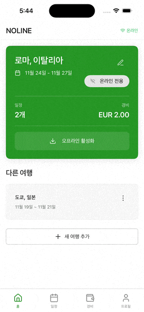
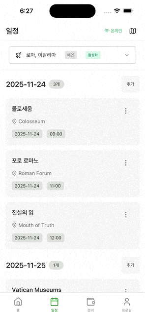
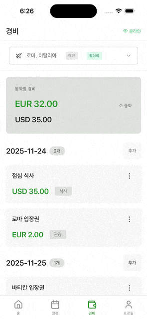
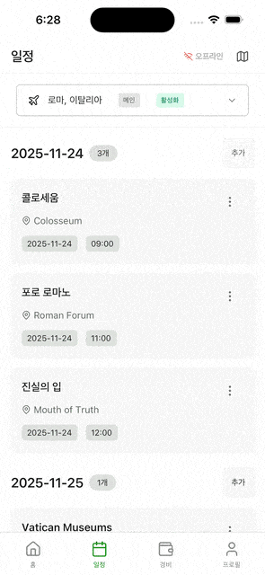
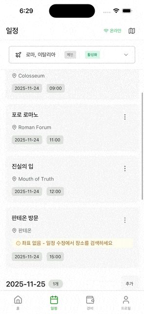

<div align="center">
  <h2>NOLINE</h2>
  <p><strong>네트워크가 없어도 여행은 계속된다</strong></p>

  <p>
    
    
    
  </p>

  <p>
    <a href="https://apps.apple.com/kr/app/noline/id6757186547">
      
    </a>
  </p>
</div>

Noline은 여행 중 연결이 끊겨도 일정 기록과 경비 관리를 이어가기 위한 **Selective Local-First iOS 앱**입니다. 필요한 여행 하나를 활성화해 기기에 데이터를 준비하고, 보존한 로컬 변경을 연결·인증이 허용될 때 서버와 동기화합니다. 지도와 경로는 실제로 준비된 지역·자원의 범위에서 사용할 수 있습니다.

이 README는 제품 소개와 설계 선택을 설명합니다. 현재 제품 계약·구현 차이의 정본은 [Project context](context/project/README.md), 처음 개발 환경을 준비하는 절차는 [START_GUIDE](START_GUIDE.md)가 소유합니다.

## 읽을 곳

| 목적 | 시작점 |
| --- | --- |
| 프로젝트가 해결하는 문제와 설계 이유 | 아래 Motivation·Architecture |
| 로컬 PostgreSQL·API·iOS 앱 시작 | [개발 시작](START_GUIDE.md) |
| 서버 환경·명령·라우트·배포 전제 | [서버 안내](apps/server/README.md) |
| 기존 DB 열 추가와 과거 SQL의 사용 조건 | [DB 스크립트](apps/server/scripts/README.md) |
| 제품 동작·현재 구현·개발 계약 | [Project context](context/project/README.md) |
| 코드 수정의 작업 진입·경로별 지침 | [프로젝트 가이드](CLAUDE.md) |

## Motivation

해외 여행에서는 비행기 탑승, 로밍 제한, 불안정한 현지 연결 때문에 서버에 항상 접근할 수 없습니다. 그때도 이미 준비한 여행의 일정을 보고 새 기록과 지출을 남길 수 있어야 합니다.

모든 여행을 항상 기기에 복제하면 지도 저장공간과 동기화 책임이 커집니다. Noline은 실제로 사용할 여행 하나에 오프라인 준비를 집중하는 방식을 선택했습니다. 핵심은 입력을 먼저 보존하고, 서버 반영과 지도 준비의 성공을 각각 확인하는 것입니다. 로컬 저장을 마쳤다는 사실이 서버 반영·지도 다운로드까지 끝났다는 뜻은 아닙니다.

이 목적과 지원 범위는 [제품 기준](context/project/common/product.md), 대안을 비교한 이유는 [Selective Local-First 결정](context/project/decisions/0001-selective-local-first.md)에 있습니다.

## Preview & Features

아래 이미지는 기능을 소개하는 기존 데모입니다. 모든 최신 경계·실패 조건을 검증하는 자료는 아닙니다.

### 필요한 여행의 오프라인 준비

<div align="center">
  
</div>

여행을 생성·편집하고 실제 사용할 여행 하나를 활성화합니다. 활성 여행은 Local SQLite를 기준으로 읽고 쓰며, 비활성 여행은 Server API를 기준으로 다룹니다. 지도·경로 준비는 별도 단계이고 활성 표시만으로 native 지도 파일과 모든 경로의 준비 완료를 보장하지 않습니다. 만료와 비활성화·정리 조건은 [데이터 수명](context/project/guidance/data-lifecycle/INDEX.md)에서 확인합니다.

### 일정과 지도

<div align="center">
  
</div>

일정을 날짜·시각과 함께 기록하고 목록과 지도를 전환합니다. 온라인에서는 장소 검색과 Google 지도를 사용하고, 활성 여행의 오프라인 지도는 준비된 Mapbox 자원을 사용합니다. 좌표 없는 일정도 장소명을 직접 입력해 저장할 수 있지만 마커·경로로 표시할 준비는 별개입니다. 나중에 사용자가 장소를 검색해 좌표를 보완할 수 있으며 자동 보강이 보장되는 것은 아닙니다.

### 다중 통화 경비

<div align="center">
  
</div>

경비를 날짜와 통화·카테고리로 기록하고 통화별로 합계를 확인합니다. 서로 다른 통화를 환율로 자동 환산해 하나의 합계로 섞지 않습니다. 경비는 같은 여행의 일정 하나에 선택적으로 연결할 수 있으며, 경비 날짜와 일정 날짜는 독립적입니다. 금액 정밀도·표시와 날짜 의미는 [통화](context/project/common/currency.md)·[날짜](context/project/common/date-and-time.md) 본문을 따릅니다.

### 로컬 변경과 서버 동기화

<div align="center">
  
  
</div>

로컬 변경과 `sync_queue`를 함께 저장하는 Outbox 방식을 사용합니다. 서버 반영은 인증·실제 연결·실행 상태를 확인한 별도 작업입니다. 연결 복구나 sync 호출의 종료만으로 모든 변경이 반영됐다고 판단하지 않습니다. 실패 상태·pull 반영·충돌 처리의 실제 경계는 [동기화 가이드](context/project/guidance/data-lifecycle/INDEX.md)가 설명합니다.

## Authentication

Google·Apple OAuth로 로그인하고 JWT access/refresh token을 사용합니다. 현재 서버 config는 access 1시간, refresh 30일로 정합니다. API의 인증 거부가 확정되면 재로그인을 안내하지만 통신 장애 자체를 로그아웃으로 처리하지 않습니다.

같은 계정의 재인증이 필요한 동안 활성 여행의 Local 이용은 유지합니다. 로그인·계정 전환·종료는 로컬 데이터와 미전송 변경의 소유권을 함께 확인합니다. 명시적 로그아웃·탈퇴로 폐기한 미전송 변경이 나중에 복구되는 기능은 없습니다. 정확한 흐름과 보호의 한계는 [앱 실행·세션·데이터 보존](context/project/current/app-runtime/INDEX.md)에 있습니다.

## Tech Stack & Structure

| 영역 | 현재 구성 |
| --- | --- |
| Client | React Native 0.74.5, Expo SDK51, TypeScript, Expo Router, React Query, Zustand |
| UI·입력 | NativeWind, React Hook Form, Zod, 공유 UI primitives |
| Local 저장 | Expo SQLite, Drizzle, sync_queue |
| 지도·검색 | native Mapbox, Google Maps·Places·Directions, GeoNames |
| Server | Node20 대상, Express4, TypeScript ESM, Drizzle, PostgreSQL, tsx/tsup |
| 계약·workspace | `@repo/schema` Zod 계약, pnpm9.6.0 workspaces |
| 배포 설정 | EAS iOS build, Render server 설정. 실제 운영 환경·DB 상태는 별도 확인 |

```text
noline/
├── apps/client/
│   ├── app/                  # Expo route·root 연결
│   └── src/
│       ├── application/      # 앱 준비·실행 수명
│       ├── screens/          # 화면 조합
│       ├── features/         # 사용자 작업·작성 흐름
│       ├── entities/         # 모델·API/Local·repository·query
│       └── shared/           # DB·Policy·인증·sync·지도·공용 UI
├── apps/server/src/          # routes·인증·서비스·PostgreSQL
├── packages/schema/          # 공유 Zod 입출력 계약
├── packages/ui/              # 공유 UI primitives
└── context/project/          # 현재 제품 의미·구현·개발 기준
```

전체 책임과 검사 범위는 [현재 구조](context/project/current/architecture.md), 계층·재사용 기준은 [개발 경계](context/project/guidance/development-boundaries/INDEX.md)를 따릅니다.

## Quick Start

처음 실행할 때는 환경 파일과 외부 서비스 설정, DB schema 적용이 먼저 필요합니다. [개발 시작 안내](START_GUIDE.md)에서 실행 대상에 맞는 API 주소·OAuth·Mapbox token을 준비한 뒤 아래 흐름을 사용합니다. 각 서버·client 명령은 별도 터미널에서 실행합니다.

```bash
# 저장소 루트: postinstall에서 공유 schema를 빌드한다.
pnpm install

# 개발 환경 파일을 준비한 뒤 DB를 시작한다.
docker compose -f apps/server/docker-compose.yml up -d

# 새 로컬 DB에 현 schema를 적용한다.
pnpm server db:push

# API 서버
pnpm server dev

# 최초 iOS native 개발 빌드
pnpm client ios
```

이미 호환 개발 앱이 설치돼 있으면 `pnpm client start`로 Metro만 실행할 수 있습니다. Expo Go는 Mapbox native 모듈을 포함한 이 앱의 실행 경로가 아닙니다. 기존 DB·기기를 처음 설치처럼 리셋하거나 과거 SQL seed를 실행하지 않습니다.

## Architecture: 선택과 책임

### 클라이언트에서 ID를 만드는 이유

오프라인 생성에는 서버가 돌려줄 ID를 기다릴 수 없습니다. 클라이언트가 `generateId()`로 ULID를 만들고 서버가 같은 ID를 수용하여 로컬 기록과 서버 기록을 연결합니다. ID 생성만으로 재전송·충돌·서버 반영이 모두 해결되는 것은 아니며 queue와 sync 계약을 함께 지켜야 합니다.

### 모든 여행 대신 활성 여행에 준비를 집중한다

지도와 데이터를 모든 여행에 준비하면 공간·준비 시간·정리 책임이 커집니다. 필요한 여행의 데이터를 Local에 두고 나머지는 서버를 기준으로 다루는 선택이 Selective Local-First입니다. 오프라인 새 여행 생성과 비활성 여행의 내용 편집은 지원 범위가 아닙니다. 저장 위치 선택은 Activation Router가 맡아 화면에서 DB/API를 임의로 고르지 않게 합니다.

### 데이터 위치와 서비스 가용성을 나눈다

활성 여행이 Local에 있다는 이유로 온라인 장소 검색과 지도를 막을 필요는 없습니다. Policy는 사용 가능 여부와 표시 모드를, Router는 데이터 실행 위치를 맡습니다. 지도·검색·길찾기는 여행 데이터와 같은 sync-owned entity가 아니므로 네트워크 조건에 따라 사용합니다. 이 분리로 사용자가 온라인/오프라인 모드를 수동으로 바꿔 데이터 소유권까지 판단하지 않게 합니다.

### 제한 속에서도 입력과 이미 얻은 맥락을 보존한다

연결이 끊기면 기본 입력을 유지하고 장소 검색·후보 조회·저장처럼 실행할 수 없는 영역을 구별해 안내하는 것이 계약입니다. 캐시를 보관하는 것과 현재 그 내용을 공개할 수 있는지도 별도 판단합니다. 현재 일정 수정 화면은 제한 시 입력 영역 전체를 교체하는 차이가 있어 계약을 모두 충족하지 못합니다. [여행 접근·초안 보존](context/project/guidance/travel-access/INDEX.md)과 [작성·입력](context/project/guidance/writing-and-input/INDEX.md)에서 적용 범위를 확인합니다.

## 저장공간과 실패를 다루는 선택

경로 geometry는 Polyline6 표현을 사용하고, native 지도 pack과 도시 metadata를 관리해 필요한 자원을 준비·재사용합니다. 과거 README의 고정 압축률·도시별 용량은 현재 측정 결과로 제시하지 않습니다. 실제 크기는 경로·지역·zoom·style에 따라 달라지며, metadata나 참조 수만으로 native tile 준비·삭제 성공을 증명할 수 없습니다. profile별 저장과 fallback, 공유 pack의 정리 범위는 [지도·경로](context/project/guidance/offline-maps-and-routes/INDEX.md)가 소유합니다.

로컬 entity 저장 뒤 queue 기록이 실패하면 서버에 보낼 근거가 빠질 수 있습니다. 그래서 두 쓰기를 같은 transaction에 둡니다. 비활성화·삭제에서는 아직 보내지 않은 작업과 원본을 함께 보존해야 합니다. 현재 여행별 cleanup은 PENDING 중심이라 FAILED·IN_PROGRESS 등 모든 미전송 상태의 보호를 충족하지 못합니다. soft delete와 vacuum이 있다는 사실을 사용자가 삭제를 되돌릴 수 있는 “7일 복구 기능”으로 소개하지 않습니다. 계약·현재 차이·변경 검사는 [데이터 수명](context/project/guidance/data-lifecycle/INDEX.md)을 따릅니다.

## 문서와 검증 범위

이 소개는 제품의 목표와 현재 지원 경계를 구별합니다. 실제 설치·DB·OAuth·native 지도·동기화 성공은 대상 환경의 실행 근거로 확인해야 합니다. 코드 검사와 실행 확인의 차이는 [개발 시작의 검사 안내](START_GUIDE.md#코드-검사와-실제-실행의-범위)에 있습니다.

제품·구조를 바꾼 담당자는 해당 Project Owner와 이 소개의 영향을 함께 확인합니다.
