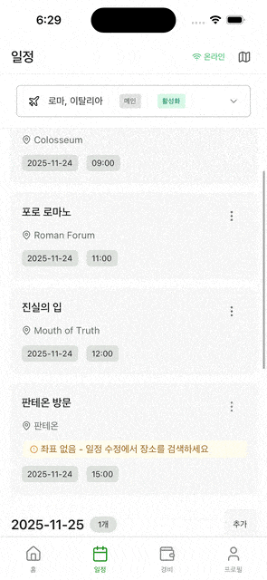
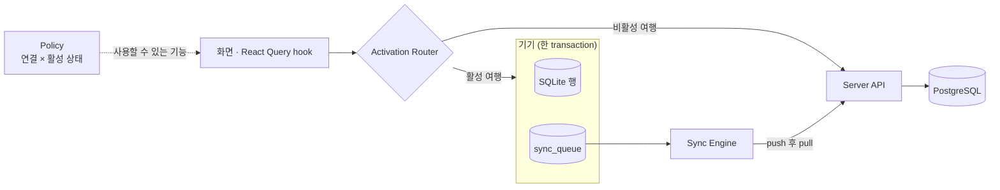

<div align="center">
  <h2>NOLINE</h2>
  <p><strong>네트워크가 없어도 여행은 계속된다</strong></p>

  <p>
    
    
    
  </p>

  <p>
    <a href="https://apps.apple.com/kr/app/noline/id6757186547">
      
    </a>
  </p>
</div>

Noline은 여행 중 연결이 끊겨도 일정 기록과 경비 관리를 이어가기 위한 **Selective Local-First iOS 앱**입니다. 필요한 여행 하나를 활성화해 기기에 데이터를 준비하고, 기기에 보존한 변경을 연결·인증이 허용될 때 서버와 동기화합니다. 지도와 경로는 미리 준비된 지역·자원의 범위에서 사용할 수 있습니다.

## 목차

- [Motivation](#motivation)
- [Preview & Features](#preview--features)
- [Architecture: 선택과 책임](#architecture-선택과-책임)
  - [1. 모든 여행 대신 활성 여행에 준비를 집중한다](#1-모든-여행-대신-활성-여행에-준비를-집중한다)
  - [2. 오프라인에서 저장한 변경을 서버까지 전달한다](#2-오프라인에서-저장한-변경을-서버까지-전달한다)
  - [3. 여러 기기의 편집은 항목 단위로 맞춘다](#3-여러-기기의-편집은-항목-단위로-맞춘다)
  - [4. 아직 보내지 못한 변경은 지우지 않는다](#4-아직-보내지-못한-변경은-지우지-않는다)
- [Tech Stack & Structure](#tech-stack--structure)
- [Quick Start](#quick-start)
- [현재 한계](#현재-한계)

## Motivation

해외 여행에서는 비행기 탑승, 로밍 제한, 불안정한 현지 연결 때문에 서버에 항상 접근할 수 없습니다. 그때도 이미 준비한 여행의 일정을 보고 새 기록과 지출을 남길 수 있어야 합니다.

모든 여행을 항상 기기에 복제하면 지도 저장공간과 동기화 책임이 커집니다. Noline은 실제로 사용할 여행 하나에 오프라인 준비를 집중하는 방식을 선택했습니다. 핵심은 입력을 먼저 보존하고, 서버 반영과 지도 준비의 성공을 각각 확인하는 것입니다. 기기에 저장을 마쳤다는 사실이 서버 반영과 지도 다운로드까지 끝났다는 뜻은 아닙니다.

## Preview & Features

<table>
  <tr>
    <td align="center" width="33%">
      <br />
      <strong>여행 활성화</strong><br />
      떠날 여행 하나를 기기에 준비
    </td>
    <td align="center" width="33%">
      <br />
      <strong>일정과 지도</strong><br />
      목록과 지도를 오가며 일정 확인
    </td>
    <td align="center" width="33%">
      <br />
      <strong>다중 통화 경비</strong><br />
      통화별로 나눠 보는 합계
    </td>
  </tr>
  <tr>
    <td align="center">
      <br />
      <strong>오프라인 직접 입력</strong><br />
      검색 없이 장소 이름으로 저장
    </td>
    <td align="center">
      <br />
      <strong>오프라인 저장</strong><br />
      보낼 변경을 기기에 보관
    </td>
    <td align="center">
      <br />
      <strong>연결 복구 후 동기화</strong><br />
      연결이 돌아오면 서버와 맞춤
    </td>
  </tr>
</table>

- **필요한 여행의 오프라인 준비** — 여행을 만들고 실제로 떠날 여행 하나를 활성화합니다. 활성화하면 그 여행의 일정과 경비를 기기로 받아 오고, 지도와 경로는 이어서 백그라운드로 준비합니다.
- **일정과 지도** — 일정을 날짜·시각과 함께 기록하고 목록과 지도를 전환합니다. 온라인에서는 장소 검색과 Google 지도를, 활성 여행의 오프라인에서는 준비해 둔 Mapbox 지도를 사용합니다.
- **다중 통화 경비** — 경비를 날짜와 통화·카테고리로 기록하고 통화별로 합계를 확인합니다. 서로 다른 통화를 환율로 환산해 하나의 합계로 섞지 않습니다. 경비는 같은 여행의 일정 하나에 연결할 수 있습니다.
- **오프라인 기록과 서버 동기화** — 활성 여행에서는 연결이 없어도 일정과 경비를 저장합니다. 장소 검색을 쓸 수 없으면 장소 이름을 직접 입력합니다. 연결이 돌아오면 기기의 변경을 서버로 보내고 서버의 변경을 받아 오며, 여러 기기에서 같은 기록을 고쳐도 각자 고친 항목이 함께 남습니다.

화면은 이전 버전에서 녹화한 데모이며 현재 UI와 다를 수 있습니다.

## Architecture: 선택과 책임



아래 네 가지는 이 구조를 만들면서 무엇을 고민했고 무엇을 포기했는지에 대한 설명입니다.

### 1. 모든 여행 대신 활성 여행에 준비를 집중한다

처음에는 모든 여행을 기기에 자동으로 저장했습니다. 여기에 오프라인 지도를 붙이자, 여행이 늘어날수록 저장 공간과 준비 시간, 정리 책임이 함께 커졌습니다.

| 검토한 대안 | 판단 |
| --- | --- |
| 모든 여행을 저장하고 활성 여행만 동기화 | 저장 공간 문제가 그대로 남는다 |
| 여행 수를 제한하고 오래된 여행을 삭제 | 임의의 제한이고 데이터를 잃을 위험이 있다 |
| 비활성 여행도 오프라인 편집 허용 | 임시 캐시와 서버 데이터의 merge·버전 충돌·정리를 모두 관리해야 한다 |
| **필요한 여행 하나만 활성화** | 채택. 실제로 떠날 여행에만 저장과 동기화 책임을 둔다 |

필요한 여행의 데이터는 기기(Local SQLite)에 두고 나머지는 서버를 기준으로 다루는 이 선택이 Selective Local-First입니다. 저장 위치는 repository가 호출하는 Activation Router가 고르므로, 화면과 hook이 DB와 API를 직접 고르지 않습니다.

```ts
// apps/client/src/entities/expense/repository/expense-repository.ts
getByTripId: async (tripId: string): Promise<Expense[]> => {
  return await routeChildQuery(tripId, {
    local: () => ExpenseLocal.getExpensesByTripIdLocal(tripId), // 활성 여행 → SQLite
    remote: () => ExpenseApi.fetchExpensesByTripId(tripId),     // 비활성 여행 → Server API
  });
},
```

#### 데이터 위치와 서비스 가용성을 나눈다

Router를 넣고 보니 활성 여행은 연결이 멀쩡할 때도 장소 검색과 Google 지도를 쓸 수 없었습니다. 일정·경비는 사용자가 소유하고 동기화하는 데이터이지만, 지도·검색·길찾기는 연결될 때 쓰면 되는 서비스입니다. 그래서 Router는 데이터 실행 위치만 맡고, 지금 쓸 수 있는 기능과 화면 표시는 Policy가 따로 정합니다. 사용자가 온라인/오프라인 모드를 직접 바꾸지 않습니다.

| 여행과 연결 | 일정·경비 데이터 | 검색·지도 |
| --- | --- | --- |
| 활성 · 온라인 | 기기에 저장하고 서버와 동기화 | 장소 검색, Google 지도 |
| 활성 · 오프라인 | 기기에 저장 | 장소 직접 입력, 준비해 둔 Mapbox 지도 |
| 비활성 · 온라인 | 서버에 저장 | 장소 검색, Google 지도 |
| 비활성 · 오프라인 | 조회·저장 제한 | 사용 제한 |

> **트레이드오프** 활성화하지 않은 여행은 오프라인에서 내용을 보거나 고칠 수 없고, 새 여행도 온라인에서 만듭니다.

선택 과정은 [Selective Local-First 결정](context/project/decisions/0001-selective-local-first.md), 상태별 세부 조건은 [여행 접근·Policy](context/project/guidance/travel-access/INDEX.md)에 있습니다.

### 2. 오프라인에서 저장한 변경을 서버까지 전달한다

오프라인 생성에는 서버가 돌려줄 ID를 기다릴 수 없습니다. 클라이언트가 `generateId()`로 ULID를 만들고 서버가 같은 ID를 수용해, 기기 기록과 서버 기록을 다시 매핑하지 않고 연결합니다.

다음 문제는 저장과 전송 사이의 틈입니다. 기기에 행만 저장되고 전송 기록이 빠지면 그 변경은 서버에 도착하지 않습니다. 그래서 행과 `sync_queue` 기록을 같은 transaction에서 확정하고(Outbox 패턴), 둘 중 하나가 실패하면 함께 되돌립니다.

```ts
// apps/client/src/entities/expense/lib/expense-local.ts (payload 일부 생략)
return await withTransaction(async () => {
  await assertActiveLocalTrip(data.tripId);

  await getDatabase().insert(expenses).values(newExpense);
  await addToSyncQueue('expenses', id, 'CREATE', { id, userId, tripId: data.tripId, /* ... */ });

  return toExpense(newExpense);
});
```

큐에 쌓인 변경을 서버로 보낼 때는 세 가지를 지킵니다.

- **순서 보존** — 큐를 쌓인 순서대로 보내고, 요청이 실패하면 뒤 작업을 멈춥니다. 수정이나 삭제가 생성보다 먼저 도착하지 않습니다.
- **횟수 제한 없는 재시도** — 실패한 작업은 다음 동기화에서 다시 보냅니다. 연결이 자주 끊기는 여행 중에는 일시 오류가 반복되므로, 횟수로 막으면 전송이 멈추고 버리면 입력을 잃습니다.
- **멱등 재전송** — 응답을 잃은 요청을 다시 보내도 서버가 중복으로 적용하지 않습니다.

> **트레이드오프** 큐가 하나라서 앞선 실패가 풀릴 때까지 뒤의 변경도 기다립니다.

저장 실패 시의 rollback은 [SQLite 테스트](apps/client/tests/shared/db/transaction-serialization.test.ts)로, 재전송의 중복 적용 여부는 [PostgreSQL 통합 테스트](apps/server/tests/integration/replay.idempotency.test.ts)로 확인합니다. 상태별 처리와 나머지 규칙은 [데이터 수명](context/project/guidance/data-lifecycle/INDEX.md)에 있습니다.

### 3. 여러 기기의 편집은 항목 단위로 맞춘다

같은 경비를 휴대폰과 태블릿에서 고쳤을 때, 행 전체를 마지막 요청으로 덮어쓰면 먼저 도착한 편집이 사라집니다.

| | 금액 | 분류 |
| --- | --- | --- |
| 처음 | 25 USD | 식비 |
| 휴대폰 (오프라인) | **30 USD**로 수정 | |
| 태블릿 | | **교통**으로 수정 |
| 두 기기 동기화 후 | 30 USD | 교통 |

Noline은 저장할 때마다 편집 표식 `{ time, sequence, id }`를 붙이고, 서버가 항목 묶음마다 표식을 비교해 남길 편집을 정합니다. 금액과 통화처럼 따로 조합하면 아무도 입력하지 않은 값이 되는 필드는 한 묶음으로 다룹니다.

```ts
// packages/schema/src/sync/field-edits.ts
const EXPENSE_EDIT_GROUPS = {
  title: ['title'],
  amount: ['amount', 'currency'], // 금액과 통화는 함께 바뀐다
  category: ['category'],
  date: ['date'],
  scheduleId: ['scheduleId'],
  // ...
} as const;
```

기기는 서버가 확인해 준 값 위에 아직 처리되지 않은 내 편집을 겹쳐 보여 줍니다. 30으로 저장한 요청의 응답을 기다리는 동안 35로 다시 고쳤다면, 30에 대한 응답이 도착해도 화면은 35를 유지합니다.

편집 표식이 없는 이전 버전 앱의 요청이 서버 값과 충돌하면 자동으로 덮어쓰지 않습니다. 원문을 보관해 두고 사용자가 다시 적용할 항목을 고릅니다.

> **트레이드오프** 표식은 편집 사이의 순서를 일관되게 정할 뿐, 실제로 누가 나중에 눌렀는지까지 알려 주지는 않습니다.

표식 발급과 응답 반영의 전체 흐름은 [여러 기기 편집 기준](context/project/guidance/data-lifecycle/edit-reconciliation.md)에 있습니다.

### 4. 아직 보내지 못한 변경은 지우지 않는다

기기 공간을 비우는 일과 사용자의 기록을 지우는 일은 다릅니다. 여행을 해제하거나 로그아웃할 때 서버에 보내지 못한 일정과 경비까지 함께 사라지면 안 됩니다.

- **여행 해제** — 미전송 변경이나 사용자의 선택을 기다리는 입력이 있으면 기기 사본을 남기고 정리를 예약합니다. 입력이 해결된 뒤에 정리하며, 그 전에 같은 여행을 다시 활성화하면 예약을 취소합니다. 기기 사본 정리는 서버의 여행을 삭제하지 않습니다.
- **기록 삭제** — 사용자가 삭제한 기록은 삭제 표시로 남아 서버 전달을 기다리고, 7일이 지난 뒤 그 행을 참조하는 전송 요청이 없을 때 실제로 지웁니다. 삭제를 되돌리는 기능은 아닙니다.
- **로그아웃·탈퇴** — 보내지 못한 변경이 남아 있으면 보류합니다. 사용자가 폐기를 명시적으로 확인한 때만 기기 데이터를 비우며, 폐기한 변경은 복구할 수 없습니다.
- **로그인 만료** — 통신 장애를 로그아웃으로 처리하지 않습니다. 재인증이 필요한 동안에도 같은 계정의 활성 여행은 기기에서 계속 이용할 수 있고, 서버 요청과 새 동기화만 멈춥니다.

정리 조건과 한계는 [여행 사본 정리](context/project/guidance/data-lifecycle/INDEX.md#여행을-정리할-때-모든-미전송-상태와-현재-활성-여부를-확인한다), 세션과 계정 종료의 흐름은 [앱 실행·세션·데이터 보존](context/project/current/app-runtime/INDEX.md)에 있습니다.

## Tech Stack & Structure

| 영역 | 현재 구성 |
| --- | --- |
| Client | React Native 0.74.5, Expo SDK 51, TypeScript, Expo Router, React Query, Zustand |
| UI·입력 | NativeWind, React Hook Form, Zod, 공유 UI primitives |
| Local 저장 | Expo SQLite, Drizzle, `sync_queue` |
| 지도·검색 | native Mapbox, Google Maps·Places·Directions, GeoNames |
| Server | Node 20, Express 4, TypeScript ESM, Drizzle, PostgreSQL, tsx/tsup |
| 인증 | Google·Apple OAuth, JWT access(1시간)·refresh(30일) token |
| 계약·workspace | `@repo/schema` Zod 계약, pnpm 9.6.0 workspaces |
| 테스트·진단 | Jest(client), Vitest·Supertest·PostgreSQL integration(server), Sentry |
| 배포 설정 | EAS iOS build, Render server 설정 |

```text
noline/
├── apps/client/
│   ├── app/                  # Expo route·root 연결
│   └── src/
│       ├── application/      # 앱 준비·실행 수명
│       ├── screens/          # 화면 조합
│       ├── features/         # 사용자 작업·작성 흐름
│       ├── entities/         # 모델·API/Local·repository·query
│       └── shared/           # DB·Policy·인증·sync·지도·공용 UI
├── apps/server/src/          # routes·인증·서비스·PostgreSQL
├── packages/schema/          # 공유 Zod 입출력 계약
├── packages/ui/              # 공유 UI primitives
└── context/project/          # 현재 제품 의미·구현·개발 기준
```

전체 책임과 검사 범위는 [현재 구조](context/project/current/architecture.md), 계층·재사용 기준은 [개발 경계](context/project/guidance/development-boundaries/INDEX.md)를 따릅니다.

## Quick Start

처음 실행할 때는 환경 파일과 외부 서비스 설정, DB schema 적용이 먼저 필요합니다. [개발 시작 안내](START_GUIDE.md)에서 실행 대상에 맞는 API 주소·OAuth·Mapbox token을 준비한 뒤 아래 흐름을 사용합니다. 서버와 client 명령은 별도 터미널에서 실행합니다.

```bash
# 저장소 루트: postinstall에서 공유 schema를 빌드한다.
pnpm install

# 개발 환경 파일을 준비한 뒤 DB를 시작한다.
docker compose -f apps/server/docker-compose.yml up -d

# 새 로컬 DB에 현 schema를 적용한다.
pnpm server db:push

# API 서버
pnpm server dev

# 최초 iOS native 개발 빌드
pnpm client ios
```

이미 호환되는 개발 앱이 설치돼 있으면 `pnpm client start`로 Metro만 실행할 수 있습니다. Mapbox native 모듈을 포함하므로 Expo Go로는 실행할 수 없습니다. 테스트와 타입 검사 명령, 각 검사가 확인하는 범위는 [검사 안내](START_GUIDE.md#코드-검사와-실제-실행의-범위)에 있습니다. 서버 환경과 라우트는 [서버 안내](apps/server/README.md), 기존 DB에 변경을 적용하는 조건은 [DB 스크립트 안내](apps/server/scripts/README.md)에 있습니다.

## 현재 한계

- iOS만 배포하고 검증합니다. Android 설정은 있지만 같은 수준으로 지원하지 않습니다.
- 활성 표시는 일정·경비 데이터를 받아 왔다는 뜻입니다. 지도 파일과 경로의 준비 완료는 별개이며, 오프라인 지도는 내려받은 도시의 범위 안에서만 보입니다.
- 연결이 끊겨도 작성 중인 입력은 유지하고 실행할 수 없는 영역만 제한하는 것이 기준이지만, 일정 수정 화면은 아직 입력 영역 전체를 제한 안내로 바꿉니다.

---

이 README는 제품 소개와 설계 선택을 요약합니다. 제품 계약과 현재 구현 차이의 정본은 [Project context](context/project/README.md)에 있습니다.
